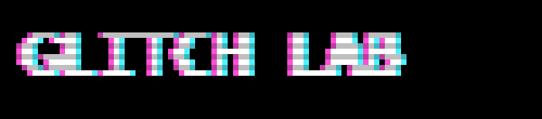
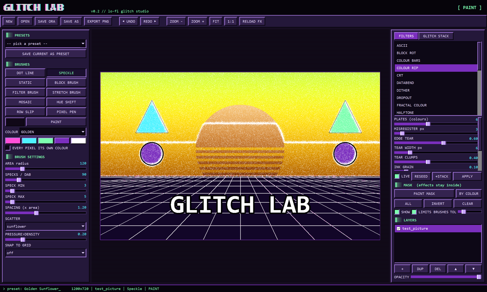
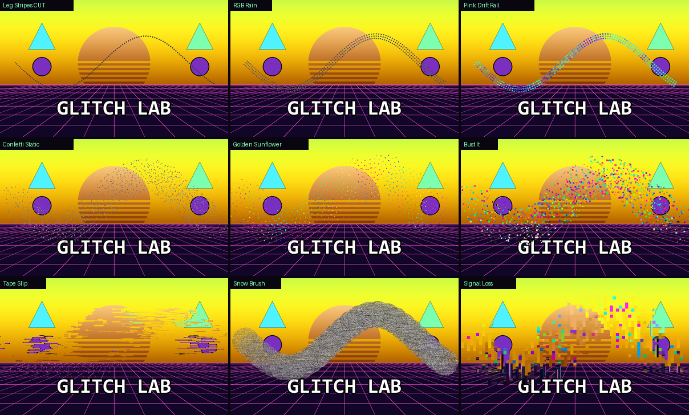
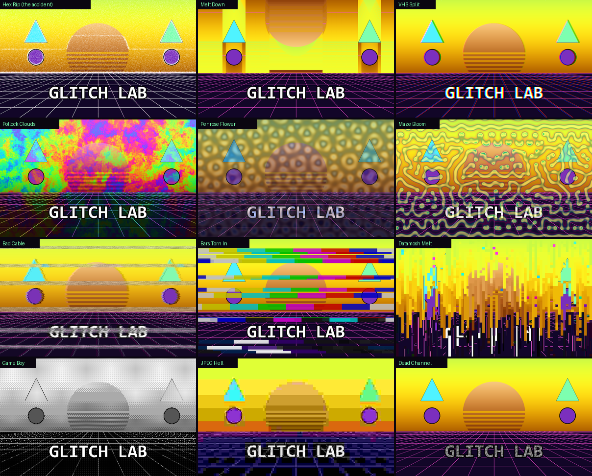

<p align="center"></p>

# Glitch Lab

> *"Every hitch gets turned into a shortcut when I persist."*

**A lo-fi glitch studio for painters.** Glitch Lab is a small editor that does one thing: break pictures
beautifully. Pen-pressure **glitch brushes** paint square-pixel dot lines, random speckle, TV static and
broken video blocks exactly where you draw, and whole-layer **glitch filters** do the rest: colour-plate rips,
VHS tape, dead-channel snow, test-card bars, JPEG/DCT rot, pixel sorting, and filters built on maths people
find beautiful (1/f fractal noise, quasicrystals, Turing patterns). Every effect is one small Python file,
so adding the next glitch you find is a 10-line job.

> **Made by JunkSmithWizard (JSW) together with Claude (Anthropic's AI).** It started as an accident: a
> half-broken layer recovery of one of JSW's drawings came out torn and speckled in a way that looked better
> than the original. JSW wanted that look on purpose, plus brushes Krita can't do. Claude wrote the code;
> JSW judged every effect by eye and steered what came next.

<p align="center"></p>

## What's in it

**Brushes** (pen pressure, the pen's eraser end erases, ERASE mode turns any brush into a hole-puncher)

| Brush | What it does |
|---|---|
| **Dot Line** | square pixel dots laid along your stroke, in the direction you draw; rows, gaps, jitter, dropout |
| **Speckle** | a fresh random scatter of square specks on every dab (never smears); scatter = random, **blue noise**, **sunflower** (golden angle), clumps |
| **Static** | paints TV snow (circle, square or scan band) |
| **Block Brush** | paints broken digital video: DCT-crushed blocks, wrong-place copies, drag-down smears |
| **Filter Brush** | paints in whatever filter is selected (pixel sort, VHS, Turing, Colour Rip...) only where the pen goes |
| **Stretch Brush** | grabs the line of pixels under the pen and drags it along the stroke (frozen-scanline smear) |
| **Mosaic** | pixelates under the brush on one fixed block grid |
| **Hue Shift** | spins the colours under the brush around the colour wheel, more each pass |
| **Row Slip** | slides thin bands of the picture sideways (pick one channel for an RGB tear) |
| **Pixel Pen** | plain hard pixel pen / eraser for cleanup |

**Colour modes** for every brush: pick, palette (5 swatches), random, pure RGB, **bust** (the drawing's own colours,
torn off a nearby spot and hue-spun), **golden** (golden-ratio hue steps: the most evenly spread colours),
**drift** (hue wanders with 1/f pink noise). Tick *every pixel its own colour* for per-pixel chaos.

<p align="center"></p>

**Filters** (whole layer, live preview while you move the sliders, APPLY keeps it, Ctrl+Z drops it)

| Filter | What it does |
|---|---|
| **Colour Rip** | k-means splits the picture into colour plates, then prints each like a screenprint: off-register, torn where colours meet, speckled |
| **Dropout** | worn-print alpha dropout (clumps + grain, protects lines) |
| **Fractal Colour** | 1/f^β noise made in the Fourier domain (the fractal statistics of clouds and of the Pollock paintings people rate most beautiful), with domain warp: hue bust, palette, thermal bands |
| **Quasicrystal** | N plane waves added together: never-repeating Penrose-like moiré; palette, hue bust, lace cut, chroma moiré |
| **Turing** | Gray-Scott reaction-diffusion (coral, spots, maze, mitosis, worms, bubbles) grown out of *your* line art |
| **TV Snow** | dead-channel static with scan streaks and a rolling bar; over, behind the drawing, or weak-signal ghost |
| **VHS / Cable** | 1/f line wobble, colour bleed, tracking bands, head-switch tear, interlace comb, tape fade |
| **Colour Bars** | SMPTE / EBU / RGB ramp test cards: behind, over, or torn in as slices |
| **Block Rot** | real JPEG maths: 8×8 DCT quantisation (colour crushed harder) + broken macroblocks |
| **CRT** | curved glass, RGB phosphor mask (aperture grille / shadow / slot), scanlines, bloom, edge fringe, vignette |
| **Halftone** | CMYK print screens at 15/75/0/45°, mono newspaper dots, or dots in each spot's own colour |
| **ASCII** | rebuilt from text characters by glyph ink: green/amber terminal, real colours or 16-colour ANSI |
| **Wave Melt** | sine waves with 1/f wobble, melting drips, swirl, ripple |
| **Databend** | edits the raw bytes: inserted/deleted bytes skew the image and rotate R>G>B, bit flips, echo runs, the WordPad save |
| **Pixel Stretch** | each column smears from where it gets bright (or dark) to the edge |
| **Kaleidoscope** | N mirrored wedges around a point: mandalas and snowflakes |
| **Game Engine** | your picture inside a PS1 / N64 / PS2 3D scene (see below) |
| **Pixel Art** | smart pixelation: dominant colour per block, lines kept |
| **Console** | 17 games machines + the screen they were played on (see below) |
| **Neon Edges** | Sobel edges coloured by the direction they run, plus glow |
| **Pixel Sort**, **RGB Shift**, **Scanlines**, **Dither** (Bayer, Game Boy), **JPEG Crush**, **Slice Shift** | the classics |

<p align="center"></p>

**Mask**: press **M** (or PAINT MASK) and any brush paints a selection instead of the picture; **BY COLOUR** then a
click grabs every similar colour. Filters, stacks and brushes then only touch the inside (pink tint shows it).
INVERT / ALL / CLEAR, and it's all undoable.

**Glitch stacks**: set up a filter, press **+STACK**, repeat; **RUN STACK** applies the whole chain as one undo step.
Save stacks as presets (*Broadcast Death*, *Zine Print*, *Hacker Terminal*, *Corrupted Download*, *Melted Tape* ship).

**Console**: renders the picture the way a machine would, then shows it on the screen it was played on. 17 systems
(NES, Game Boy / Color / Advance, Master System, Mega Drive, SNES, PlayStation, N64, PS2, Xbox 360, Dreamcast,
Atari 2600, C64, DOS CGA / VGA, Virtual Boy): real resolution, palette or colour depth, dithering and one signature
quirk each (NES tile clash + sprite flicker, PS1 vertex wobble, N64 fog, Mega Drive rainbow dither, SNES mosaic...),
then a composite / RF / RGB tube TV with dot crawl and beam-shaped scanlines, the handheld LCD with its pixel grid
and ghosting, a monitor or an HDTV.

**Game Engine**: a small software 3D renderer puts the picture *inside* a scene (poster in a brick room, cut-out standing
in a field, spinning cube, Mode 7 floor, endless corridor) and draws it the way the hardware did: PS1 affine texture
warping, vertex snapping jitter, no depth buffer and the PS1 dither; N64 tiny 64 px textures, bilinear blur, fog and
the soft video filter; PS2 sharper textures, haze and bloom. Floor (checker, grass, stone, tiles, wood, sand, water,
brick or your own picture), walls, colours and the sky / fog (day, night, sunset, vapor, toxic, void, blood, underwater...)
are all tweakable. Then it goes through the Console TV.

**Pixel Art**: smart pixelation. Each big pixel keeps its block's dominant colour (k-centroid, the method behind
Astropulse's K-Centroid and PixelOE) and dark line work wins its block, so a drawing becomes crisp sprite art instead
of blurry mush. Palette reduction and a sprite outline on top. The Game Engine uses it for its textures.

**GIF mode** (GIF tab): tick it and APPLY, RUN STACK and the Filter Brush stop changing the still picture and add
steps to a loop instead. Random effects re-roll every frame (snow crawls, VHS rolls, block rot flickers), SWEEP makes
any slider travel A > B > A so the loop closes, masks keep the movement inside. Preview plays on the canvas;
export MP4 (ffmpeg, small, Discord-ready) or GIF.

**Preset browser** (BROWSE): every preset as a thumbnail, search, categories, favourites, and *Mine* for your own.

130 presets ship in `presets.json`; **SAVE AS PRESET** adds yours.

## Install and run

Windows, Python 3.10+:

```
pip install -r requirements.txt
python glitchlab.py            (or double-click "Glitch Lab.bat", or drag a PNG onto it)
```

- Opens PNG / JPG / **ORA** (layers kept). Saves layered **.ora**, which Krita opens with every layer intact.
  **Export PNG** writes a flat copy. It never overwrites the file you opened, and autosaves every 3 minutes.
- Pen: Windows Ink tablets (pressure + eraser end). Mouse works too. Fingers pan, two fingers pinch-zoom.
- Keys: **E** paint/erase, **M** mask mode, **[ ]** brush size, **+ / -** zoom, wheel zoom, space-drag pan, **F** fit, **1** 100%,
  **Ctrl+Z / Ctrl+Y** undo/redo, **Ctrl+Enter** apply filter, **Ctrl+S** save.

`glitch_tex.py` / `glitch.bat` is the original command-line dropout texture: drag PNG layers onto the .bat.

## Add your own glitch

Drop a file in `effects/` and press **RELOAD FX** (restart for a new button). Sliders and presets come for free.

```python
"""My filter: shows as a tooltip."""
import numpy as np

NAME = 'Invert Bands'
KIND = 'filter'
PARAMS = [P('every', 'EVERY N px', 2, 200, 40)]          # key, label, min, max, default

def apply(img, p, rng):                                   # img: HxWx4 uint8, return a new one
    out = img.copy()
    rows = (np.arange(img.shape[0]) // p['every']) % 2 == 1
    out[rows, :, :3] = 255 - out[rows, :, :3]
    return out
```

A brush gives `spacing(p, pressure)` and `dab(ctx, x, y, pressure, angle)` instead and stamps with
`ctx.square(x, y, size)`, which already handles erase mode and all the colour modes. See `gl/effects.py`.

## License

MIT. See [LICENSE](LICENSE). The test picture in `assets/` is generated (shapes and a gradient), not artwork.
